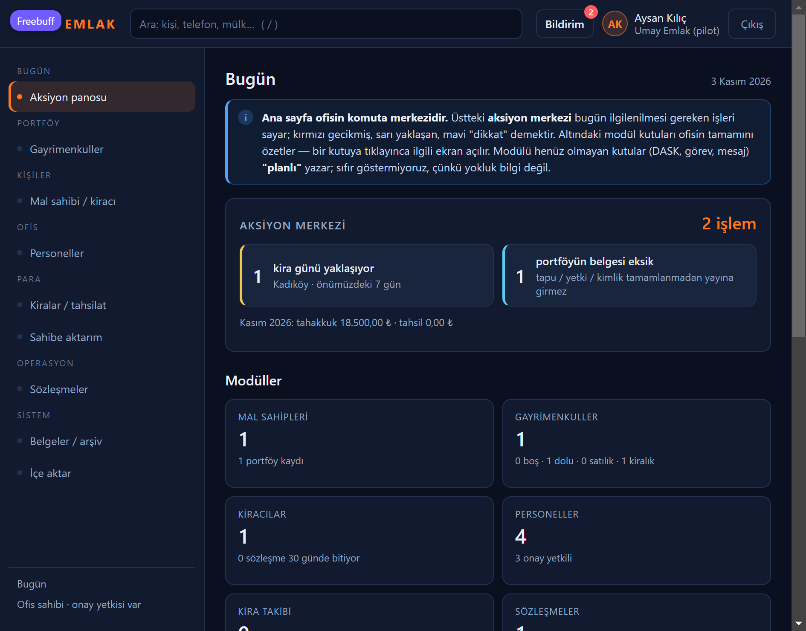
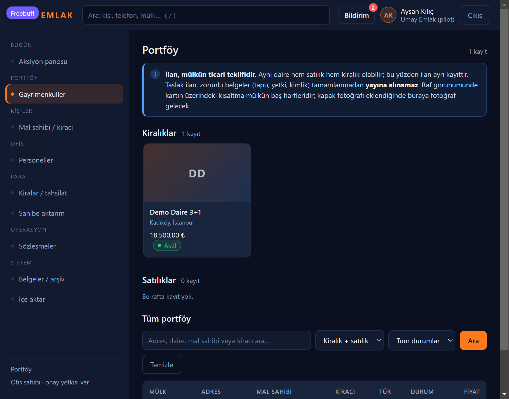
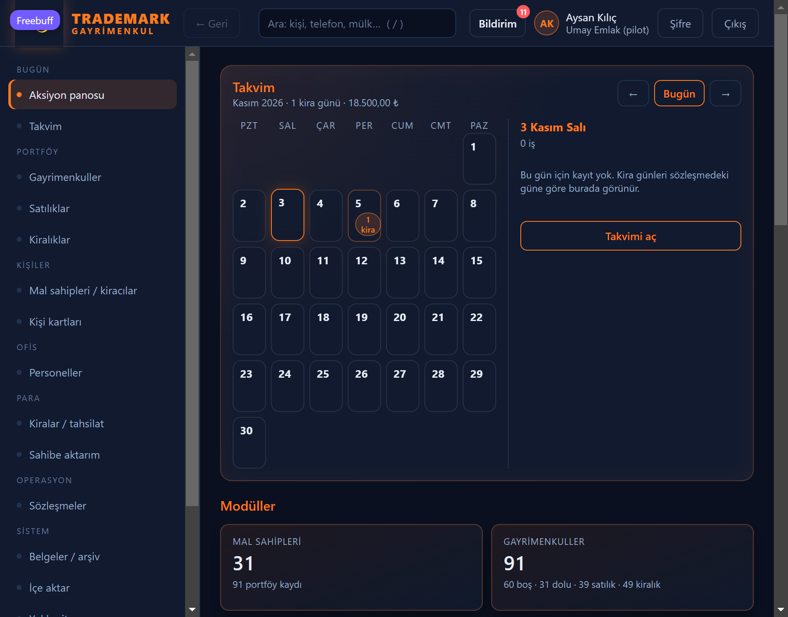
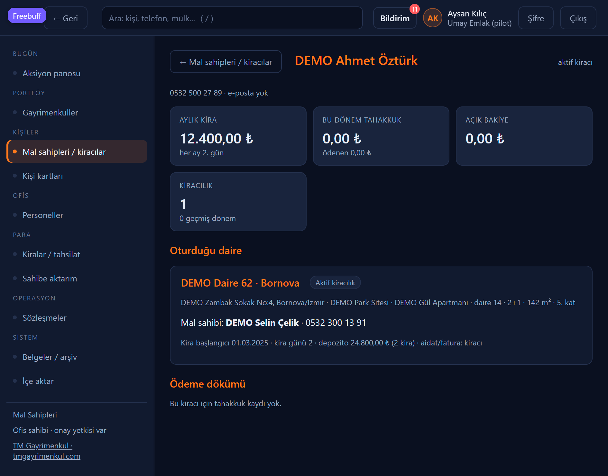
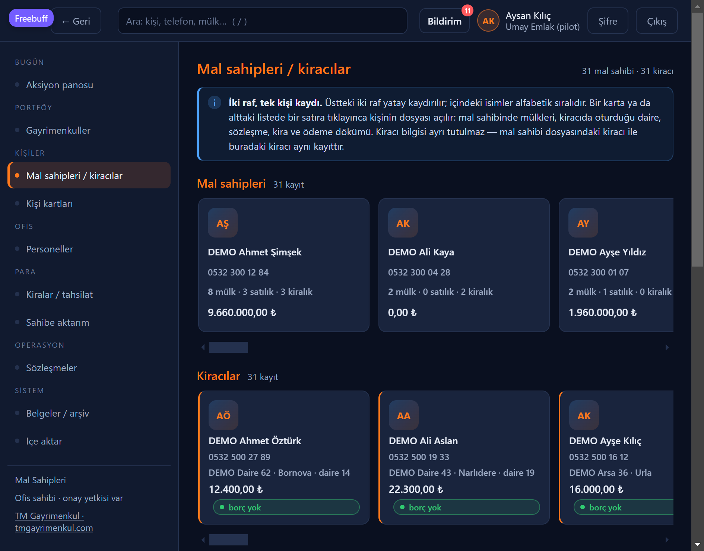
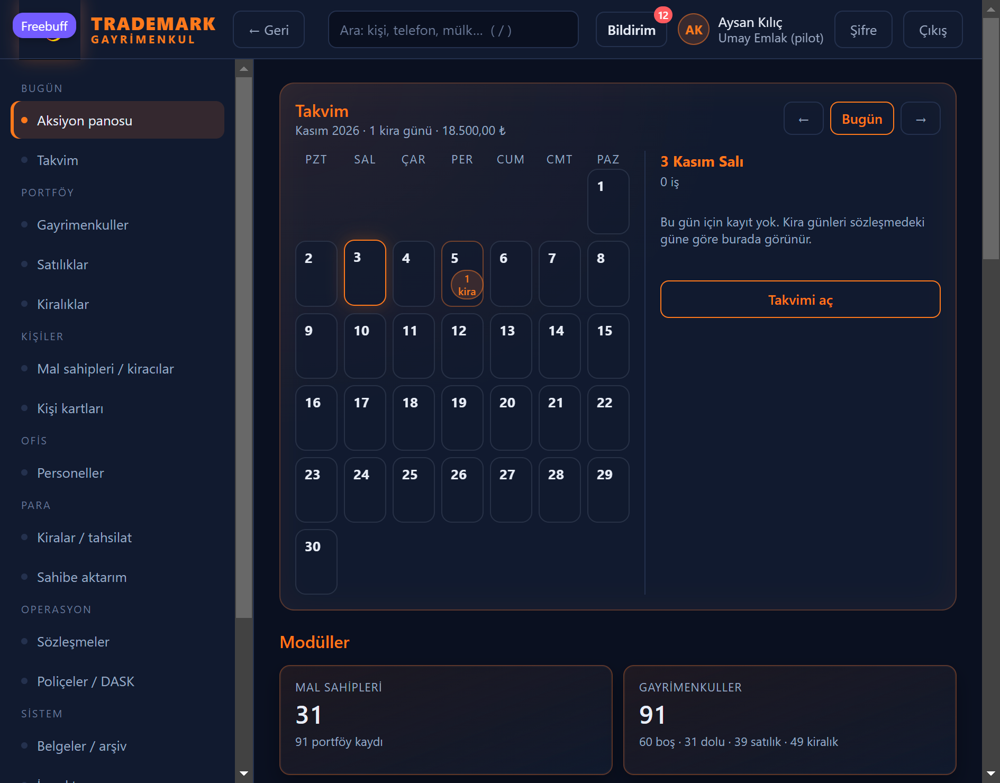

# UMAY EMLAK — Trademark Gayrimenkul Yönetim Programı

Çok kiracılı (multi-tenant) emlak ofisi yönetim programı. Masaüstü tarayıcıda çalışan
React arayüzü + Hono/PostgreSQL API'si.

> Gerçek müşteri verisi, `.env` sırları ve yerel yedekler depoya girmez (K-19).
> Demo veriler `DEMO ` önekiyle üretilir ve tek komutla silinir.

## Ekran Görüntüleri

| Ana sayfa | Portföy |
|---|---|
|  |  |

| Mülk dosyası | Kiracı dosyası |
|---|---|
|  |  |

| Kişiler | Poliçeler |
|---|---|
|  |  |

Daha fazla ekran: depo kökündeki `ekran-*.png` dosyaları.

## Neler var?

- **Portföy**: satılık/kiralık raf ekranları, mülk dosyası (fotoğraf/video, mal sahibi,
  oda/m²/kat/adres), fiyat ve durum geçmişi.
- **Kiracılık**: sözleşme (dondurulmuş snapshot + A4 metin), kira tahakkuku/tahsilatı,
  gecikme kademeleri, teslim tutanağı ve depozito iadesi.
- **Kira artışı**: TÜİK oranı elle girilir, taslak üretilir, yetkili onayıyla sözleşmeye işlenir.
- **Poliçe/DASK**: mülk bazlı poliçe, bitişten 30 gün önce uyarı, ana sayfa kutusu.
- **Randevu / yer gösterme**: aday + portföy + personel, sonuç (geldi/gelmedi/iptal) ve not;
  takvimde saatli iş olarak görünür.
- **Belgeler**: sha256 içerik adresli arşiv + otomatik eşleştirme önerisi ve onayı.
- **Yetki**: ofis/rol bazlı üyelik, onay yetkisi (`can_approve`), PostgreSQL RLS ile kiracı izolasyonu.

## Kurulum (geliştirme)

Gereksinim: Node 22+, pnpm 11+, PostgreSQL 17 (veya `docker compose up -d`).

```bash
pnpm install
cp .env.example .env         # DATABASE_URL / MIGRATE_DATABASE_URL / SESSION_SECRET
pnpm db:migrate              # şema + RLS + uygulama rolü (umay_app)
pnpm db:seed                 # ofis + ilk kullanıcı
pnpm demo:seed               # isteğe bağlı: 30 mal sahibi / 90 mülk / kira / teklif
pnpm dev                     # API :3100
pnpm dev:web                 # arayüz :5173
```

Giriş: `aysan.kilic@umay-emlak.local` / `Umay!2026` (demo).

## Kontroller

```bash
pnpm -r typecheck
pnpm test                    # API + DB izolasyon + para testleri
pnpm --filter @umay/web build
```

## Kayıt dosyaları

Proje kararları ve iş geçmişi kökteki Türkçe dosyalarda tutulur:
`00-BASLA-BURADAN.txt`, `01-BLUEPRINT.txt`, `03-LOG.txt`, `04-KARARLAR.txt`,
`06-YAPILMAYAN-SONRAYA-BIRAKILAN.txt`, `09-BILGI-BANKASI-KARSILASTIRMA.txt`.
Her turda `03-LOG.txt`'e tarihli kayıt düşülür; yapılan işler `06`'da silinmeden
"YAPILDI" olarak işaretlenir.

## Yapı

```
apps/web        React + Vite arayüzü
apps/api        Hono API (oturum, rotalar)
packages/db     Drizzle şema, migration'lar, RLS, demo veri
packages/shared para/tarih yardımcıları
```
